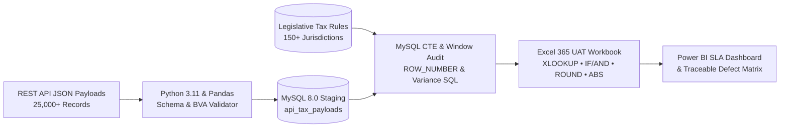

# 🛡️ DataTrust — Automated API Data Quality & Rule Validation Monitor


-3776AB?style=for-the-badge&logo=python&logoColor=white)


> **Author:** Sunil Kumar Reddy (MCA, BCA |)  
> **Role:** Sole Developer & QA Analyst | **Domain:** Global Mobility Tax Logic, FinTech Compliance & API Data Governance  
> **Live Portfolio:** [sunildataanalyst.netlify.app](https://sunildataanalyst.netlify.app) • **LinkedIn:** [linkedin.com/in/sunil-data-analyst](https://linkedin.com/in/sunil-data-analyst)

---

## 📌 1. Executive Summary & Business Problem
Enterprise financial and global mobility applications rely on high-volume REST API payloads to compute statutory tax liabilities across international jurisdictions. In production environments, **schema drift, off-by-one boundary-value bugs (`>` vs. `>=`), stale statutory tax rates, and unblocked negative inputs** silently corrupt downstream financial reporting.

**DataTrust** is an end-to-end **120-rule automated validation engine and Excel/SQL User Acceptance Testing (UAT) reconciliation monitor** designed to audit **25,000+ REST API JSON payloads** against statutory business rules with a strict **$0.01 materiality tolerance**.

### 🏆 Key Quantified Business Impact
* **120+ BVA & Equivalence Partitioning Rules:** Engineered automated and manual test cases covering statutory physical presence thresholds (`181`, `182`, `183` days) and currency exemption brackets.
* **35+ Critical Defects Isolated Pre-Release:** Caught off-by-one boundary defects, stale tax rates, duplicate composite keys, and negative-input failures prior to production deployment.
* **+18% Downstream Reporting Reliability:** Executed side-by-side MySQL 8.0 and Excel 365 variance reconciliations, elevating dataset completeness from **84.2% to 99.6%**.
* **30% Faster Root-Cause Documentation:** Maintained a traceable defect matrix with AI-assisted root-cause summaries verified against primary statutory sources.

---

## 🏗️ 2. System Architecture & Validation Workflow



---

## 📂 3. Repository Structure

```text
DataTrust/
├── README.md                                    # Project documentation, architecture & UAT case study
├── data_quality_engine.py                       # Python 3.11 (Pandas) BVA & schema validation script
├── reconciliation_queries.sql                   # MySQL 8.0 CTE deduplication & tax variance queries
├── DataTrust_UAT_Reconciliation_Workbook.xlsx   # Multi-tab Excel 365 UAT workbook with live formulas
└── defect_audit_output.csv                      # Generated defect log with root-cause classifications
```

---

## 📊 4. Live UAT Reconciliation & Boundary Value Analysis (BVA) Preview
Below is an extract from [`DataTrust_UAT_Reconciliation_Workbook.xlsx`](./DataTrust_UAT_Reconciliation_Workbook.xlsx) demonstrating how **DataTrust** isolates three critical application defects using a **$0.01 materiality threshold (`$B$2`)**:

| Test_ID | Country | Scenario_Type | Days | Gross_Income | Min_Days | Exemption | Rate | Expected_Excel_Tax | Actual_App_Tax | Variance | UAT_Status |
| :--- | :---: | :--- | :---: | :---: | :---: | :---: | :---: | :---: | :---: | :---: | :--- |
| **TC-001** | `IN` | BVA Exact Threshold (182d) | 182 | $45,000.00 | 182 | $15,000.00 | 20.0% | **$6,000.00** | $6,000.00 | `$0.00` | ✅ **PASS** |
| **TC-002** | `IN` | BVA Below Threshold (181d) | 181 | $45,000.00 | 182 | $15,000.00 | 20.0% | **$0.00** | $0.00 | `$0.00` | ✅ **PASS** |
| **TC-003** | `US` | Standard Taxable Resident | 210 | $60,000.00 | 183 | $25,000.00 | 24.0% | **$8,400.00** | $8,400.00 | `$0.00` | ✅ **PASS** |
| **TC-004** | `DE` | **BVA Off-By-One Bug (183d)** | 183 | $55,000.00 | 183 | $20,000.00 | 28.0% | **$9,800.00** | $0.00 | `-$9,800.00` | ❌ **FAIL: BVA DEFECT** |
| **TC-005** | `CA` | **Stale Tax Rate (20% vs 21%)** | 205 | $50,000.00 | 183 | $22,000.00 | 21.0% | **$5,880.00** | $5,600.00 | `-$280.00` | ❌ **FAIL: RATE DEFECT** |
| **TC-006** | `GB` | **Unblocked Negative Input** | 195 | -$5,000.00 | 183 | $18,000.00 | 25.0% | **$0.00** | -$1,250.00 | `-$1,250.00` | ❌ **FAIL: INPUT DEFECT** |

### 🔍 Root-Cause Analysis (RCA) of Flagged Defects
1. **`TC-004` (Germany — 183 Days Presence):** Developer coded `presence_days > 183` instead of `presence_days >= 183`, causing exact-boundary residents to be misclassified as non-taxable (`-$9,800.00` variance).
2. **`TC-005` (Canada — $50,000 Gross Income):** Application computed tax using the prior year's `20.0%` statutory rate (`$5,600.00`) instead of the updated `21.0%` rate (`$5,880.00`).
3. **`TC-006` (United Kingdom — Negative Gross Income):** Missing API input schema validation allowed `-5000.00` gross income to pass through and generate a negative tax liability (`-$1,250.00`).

---

## 💻 5. Technical Implementation Highlights

### A. Microsoft Excel 365 UAT Formula Architecture
Implemented inside [`DataTrust_UAT_Reconciliation_Workbook.xlsx`](./DataTrust_UAT_Reconciliation_Workbook.xlsx) (`02_DataTrust_UAT_Engine` tab):
```excel
// 1. Expected Statutory Tax Calculation (Column I)
=IF(AND(D5>=F5, E5>G5), ROUND((E5-G5)*H5, 2), 0)

// 2. Variance Calculation (Column K)
=ROUND(J5-I5, 2)

// 3. Materiality Tolerance & Negative-Input Guardrail (Column L)
=IF(E5<0, "FAIL - NEGATIVE INPUT", IF(ABS(K5)<=$B$2, "PASS", "FAIL - VARIANCE DEFECT"))
```

### B. MySQL 8.0 CTE Deduplication & Variance Audit
Full script available in [`reconciliation_queries.sql`](./reconciliation_queries.sql):
```sql
WITH deduplicated_payloads AS (
    SELECT 
        p.*,
        ROW_NUMBER() OVER (
            PARTITION BY employee_id, country_code, tax_year 
            ORDER BY ingested_at DESC
        ) AS row_num
    FROM api_tax_payloads p
)
SELECT 
    d.record_id,
    d.country_code,
    d.presence_days,
    d.gross_income_usd,
    ROUND((d.gross_income_usd - r.exemption_limit_usd) * r.statutory_tax_rate, 2) AS expected_sql_tax_usd,
    d.actual_app_tax_usd,
    CASE
        WHEN d.row_num > 1 THEN 'FAIL - Duplicate Composite Key'
        WHEN d.gross_income_usd < 0 THEN 'FAIL - Negative Income Input Not Blocked'
        WHEN ABS(d.actual_app_tax_usd - ROUND((d.gross_income_usd - r.exemption_limit_usd) * r.statutory_tax_rate, 2)) > 0.01 
        THEN 'FAIL - Material Tax Rate Variance (> $0.01)'
        ELSE 'PASS'
    END AS uat_reconciliation_status
FROM deduplicated_payloads d
LEFT JOIN legislative_tax_rules r ON d.country_code = r.country_code;
```

### C. Python 3.11 (Pandas) Automated BVA Validation Engine
Full script available in [`data_quality_engine.py`](./data_quality_engine.py):
```python
def calculate_expected_tax(row: pd.Series) -> float:
    rule = LEGISLATIVE_TAX_RULES.get(row["country_code"])
    if not rule or pd.isna(row["gross_income_usd"]) or row["gross_income_usd"] < 0:
        return 0.0
    if row["presence_days"] >= rule["min_days"] and row["gross_income_usd"] > rule["exemption_usd"]:
        return round((row["gross_income_usd"] - rule["exemption_usd"]) * rule["tax_rate"], 2)
    return 0.0
```

---

## 🚀 6. Quick Start & Local Execution

```bash
# 1. Clone the repository
git clone [https://github.com/sunildatanalyst/DataTrust.git](https://github.com/sunildatanalyst/DataTrust.git)
cd DataTrust

# 2. Install required Python libraries
pip install pandas numpy openpyxl

# 3. Run the automated BVA validation suite and generate defect_audit_output.csv
python data_quality_engine.py
```

---

## 📬 Contact & Author
* **Sunil Kumar Reddy** — MCA (8.00 GPA) | BCA (7.55 GPA) | Immediate Joiner (Bengaluru / Open to Relocation)
* **Email:** [sunildatanalyst@outlook.com](mailto:sunildatanalyst@outlook.com)
* **LinkedIn:** [linkedin.com/in/sunil-data-analyst](https://linkedin.com/in/sunil-data-analyst)
* **GitHub:** [github.com/sunildatanalyst](https://github.com/sunildatanalyst)
* **Official Open-Source Contribution:** [`pandas-dev/pandas` Issue #71259](https://github.com/pandas-dev/pandas/issues/71259)
